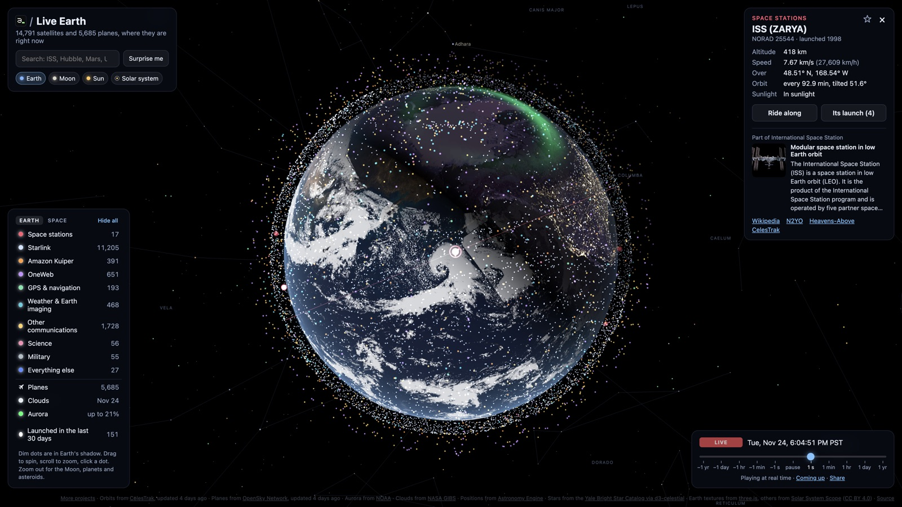
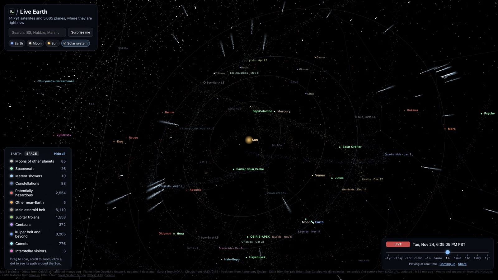

# live-earth

[](https://github.com/andrewmacheret/live-earth/actions/workflows/deploy.yml) [](https://github.com/andrewmacheret/live-earth/actions/workflows/canary.yml) [](https://github.com/andrewmacheret/live-earth/blob/main/LICENSE.md)

A 3D globe showing every active satellite where it is right now, then the rest of the solar system out to the edge of the Sun's bubble. Built with [React](https://react.dev/), [three.js](https://threejs.org/), [satellite.js](https://github.com/shashwatak/satellite-js) and [Astronomy Engine](https://github.com/cosinekitty/astronomy).

Live at [andrewmacheret.com/projects/live-earth](https://andrewmacheret.com/projects/live-earth/).



## What you can see

### Around the Earth

- **Satellites:** Starlinks, the ISS and everything else CelesTrak tracks, moving in real time. The ones in Earth's shadow are drawn dim.
- **Day and night:** the sunrise line and city lights are where they really are.
- **Clouds:** yesterday's, from NASA.
- **Aurora:** tonight's northern and southern lights, from NOAA's live forecast.
- **Eclipses:** the Moon's shadow crosses the Earth during a solar eclipse, and the Moon turns red during a lunar one.
- **Stars:** the real ones you can see without a telescope, with the 88 constellations.

### Out in the solar system

- **The Sun, Moon and planets,** with their rings and real tilts and spins. The Moon shows its real phase.
- **9 dwarf planets,** Pluto, Ceres, Eris, Haumea and Makemake, plus the likely ones Gonggong, Quaoar, Sedna and Orcus.
- **85 moons,** from Io, Titan and Triton down to Pluto's tiny Styx.
- **About 19,000 asteroids and comets:** the asteroid belt, Jupiter's trojans, the Kuiper belt, famous comets like Halley's (with tails), and the three visitors from other stars, like 3I/ATLAS.
- **26 spacecraft,** like Voyager 1, Parker Solar Probe and Webb.
- **Lagrange points, meteor shower streams and the heliosphere,** the bubble the Sun's wind blows.



### Getting around

- Click anything to see what it is, how far away it is and how fast it's going. **Ride along** follows a satellite.
- Zoom out, search, or use the **Go to** buttons to visit the Moon, the Sun or the whole solar system. You can zoom out to about 4,000 AU, far enough to see all of Sedna's orbit.
- The clock runs up to a year per second, forward or backward.
- **Coming up**, under the clock, lists the next year of eclipses, meteor showers, planets, flybys and comets. Click one to watch it.
- **Share** copies a link that opens on the same time, speed and view. A link made while live stays live.
- The legend can hide any group, like Starlink, the constellations or the meteor showers.

## Where the data comes from

| What | Source | How it gets to the page |
|---|---|---|
| Satellite orbits | [CelesTrak](https://celestrak.org/) | Daily Lambda run |
| Sun, Moon, planets and Pluto | [Astronomy Engine](https://github.com/cosinekitty/astronomy) | Worked out in the browser |
| Other dwarf planets | JPL's [Small-Body Database](https://ssd-api.jpl.nasa.gov/doc/sbdb_query.html) | Orbits copied into the code |
| Asteroids and comets | JPL's Small-Body Database | Daily Lambda run |
| Moons and spacecraft | JPL's [Horizons](https://ssd.jpl.nasa.gov/horizons/) | Daily Lambda run |
| Aurora | NOAA's [OVATION forecast](https://www.swpc.noaa.gov/products/aurora-30-minute-forecast) | Downloaded by the page |
| Clouds | NASA's [GIBS](https://www.earthdata.nasa.gov/engage/open-data-services-software/earthdata-developer-portal/gibs-api) | Downloaded by the page |
| Stars and constellations | Yale Bright Star Catalog via [d3-celestial](https://github.com/ofrohn/d3-celestial) | Saved in the code |

CelesTrak and JPL don't allow calls from web pages, so Lambda `LiveEarth` saves their data next to the page once a day. NOAA and NASA GIBS do, so the page calls them itself.

## How it works

### Satellites

Lambda `LiveEarth` (`lambda/handler.js`) runs once a day at 02:30 UTC from the EventBridge rule `LiveEarthRefresh`. It downloads the latest orbits for every active satellite from CelesTrak and writes them to `data/satellites.json`, cached for 5 minutes.

CelesTrak only allows one download per IP every 2 hours and can be slow, which is why the page never calls it directly. Day-old orbits put satellites a few kilometres off, which you can't see on the globe. Data sources, in the footer, shows how old the data is.

A web worker (`src/sats/propagate.worker.js`) runs the SGP4 orbit model for every satellite about 20 times a second. Each frame moves the dots along their velocity in between.

### The Earth and sky

The Earth spins under the orbits using sidereal time, and the Sun's position lights it.

**Stars.** About 5,000 stars, sized by brightness and colored by temperature, with the constellations' stick figures and names and the brightest stars' names. They're saved in `src/space/sky.json` by `node scripts/fetch-sky.js`, which only needs to run again to change what's kept.

**Aurora.** NOAA's forecast is the chance of seeing the aurora overhead on a 1° grid, redone every few minutes. The page downloads it every 10 minutes (about 150 kB) and draws it as a glow 110 km up on the night side, green and turning red and purple where it's strong (`src/space/aurora.js`, `src/globe/aurora.js`). It fades out when the clock is more than a few hours from now.

**Clouds.** A true color picture of the whole Earth, stitched from the VIIRS camera on NOAA-20 (`src/space/clouds.js`). The newest day is still filling in for hours after midnight UTC, so the day before fills its gaps. The picture shows the ground too, so the shader keeps only what's bright, grey and brighter than the Earth's own map there, which leaves out deserts and ice (`src/globe/clouds.js`). The two pictures are about 1 MB.

**Eclipses.** The Earth's shader works out how much of the Sun the Moon covers from each spot, so the Moon's shadow crosses the Earth and city lights come on in totality. The Moon's shader does the same with the Earth's shadow, dark red in the middle. The Sun, Moon and Earth panels show the next eclipse from Astronomy Engine (`src/space/eclipses.js`), skipping the faint penumbral lunar ones. **Watch it** jumps the clock to just before the peak at a minute a second and turns the camera to the shadow.

### Planets, moons and rings

Astronomy Engine works out the Sun, Moon, planets and Pluto's positions, tilts and spins in the browser (`src/space/bodies.js`). It doesn't know the other dwarf planets, so their orbits are copied from JPL's Small-Body Database. They stay within 0.05° of where Horizons puts them.

Scene units stay Earth radii all the way out, and the camera's near plane follows the zoom so far-away things still draw in the right order. Planet maps only download the first time a planet is big enough to see.

**Rings.** Saturn's rings use a picture. The fainter rings of Jupiter, Uranus and Neptune are drawn from a list of each ring's edges.

**Moons** come from Horizons (`src/space/moons.js`). The daily Lambda run asks for each moon's orbit once a day for a year either side of today, fits a steady orbit that slowly turns, and saves it to `data/moons.json` (about 13 kB). The page places each orbit around its planet's equator using the planet's tilt from Astronomy Engine.

- Pluto's small moons circle the balance point between Pluto and Charon, so they're measured from there.
- Horizons doesn't know the other dwarf planets' tilts, so their moons are measured against Earth's equator. It has no orbits for the moons of Haumea and Makemake.
- Most moons stay within 1% of their real spot. A few drift by up to 15% of their orbit's size: Hyperion and Helene, Epimetheus (which swaps orbits with Janus), and the far-out moons the Sun tugs on, like Pasiphae.

**Lagrange points** for the Sun and Earth, the Earth and Moon, and the Sun and Jupiter show once they're far enough from their bodies on screen (`lagrangePoints` in `src/space/bodies.js`).

**The heliosphere** shows past the planets: the termination shock, where the Sun's wind slows down, and the heliopause, where the bubble ends. Both are squashed on the side the interstellar wind comes from and stretched behind, about where the Voyagers crossed them.

**Meteor showers.** The dust streams behind 10 showers, like the Perseids and Geminids, are drawn along their parent comets' orbits (`src/space/meteors.js`). Each shower's name sits where the Earth meets its stream at the peak. Click a name, or search for it, to light up the stream and see the next peak, meteors an hour and parent comet.

### Asteroids and comets

The daily Lambda run saves about 19,000 from JPL's Small-Body Database to `data/small-bodies.json` (`src/space/smallBodies.js`):

- every asteroid brighter than magnitude 13
- every potentially hazardous asteroid
- every numbered comet, and every other comet passing the Sun within 3 years of today
- Hale–Bopp, NEOWISE and the three interstellar objects, 'Oumuamua, Borisov and 3I/ATLAS

A JPL problem only gets logged and leaves yesterday's file. The page downloads the file the first time you zoom out or search, then solves Kepler's equation for each rock a few times a second (`src/globe/rocks.js`).

Comets that pass once and never come back are on open orbits instead of ellipses, so they get their own version of Kepler's equation and a line that runs in from far away and back out. Comets inside about 5 AU grow a tail pointing away from the Sun that gets longer as they get closer.

### Spacecraft

The daily Lambda run saves a year either side of today from Horizons to `data/spacecraft.json` (`src/space/spacecraft.js`). It asks for a position every 6 hours (every 30 minutes during flybys), then keeps only the ones the page needs to rebuild the rest within 500 km. The page fills in between with a cubic that matches both positions and speeds.

- Parker swings past the Sun too fast for that, so it's saved as one ellipse. So are the craft circling Mars and the Moon every few hours, around their planet.
- Webb and the craft near L1 and L2 are saved from the Earth instead of the Sun, and Juno from Jupiter.
- The craft leaving the solar system keep going straight past the saved year.

### Coming up and Share links

Coming up (`src/space/events.js`) finds the next year of events with Astronomy Engine: eclipses, meteor shower peaks, the outer planets at opposition, Mercury and Venus at their farthest from the Sun, planets passing close in the sky, solstices and equinoxes, and Earth's closest and farthest points from the Sun.

Once the spacecraft and asteroids load, it adds flybys, found by looking for each craft's closest pass to a planet or famous asteroid. It also adds Parker's closest passes of the Sun and famous comets' closest passes. Clicking one sets the clock a little before it and points the camera at it.

Share links (`src/links.js`) save the time, speed, what the camera is looking at and where it sits.

## Planes (parked)

The page can draw live planes from `data/planes.json` (see `src/planes/`), but there's no data source yet, so it shows none. When the file is missing, the page asks once and then stops.

The plan was Lambda `LiveEarthPlanes` (`lambda/planes.js`) behind CloudFront, fetching [OpenSky Network](https://opensky-network.org/) at most every 3 minutes and only while someone is looking. That doesn't work because OpenSky blocks AWS addresses, and its docs ask people not to work around the block. The Lambda, its IAM role and its function URL exist, but CloudFront doesn't route to them yet.

About a quarter of OpenSky planes report positions minutes to hours old as if they were current. `toCompactPlanes` drops a plane whose position jumped further than its speed allows since the previous snapshot.

## Development

Built with [Vite](https://vite.dev/). Needs Node.js 24.

```bash
npm install

# copy the live site's orbit data into public/data/, and download moons, asteroids, comets and spacecraft from JPL
npm run fetch-data

# or download the satellites from CelesTrak yourself (at most once every 2 hours)
node scripts/fetch-satellites.js --celestrak

# dev server on http://localhost:5173
npm run dev

npm test

# production build in dist/
npm run build
```

## Health check

Once a day, the Canary workflow (`.github/workflows/canary.yml`), started by [andrewmacheret/canary](https://github.com/andrewmacheret/canary), checks:

- the page, its scripts and styles, and the textures, star catalog and worker those scripts load
- that the Lambda rewrote the satellite, asteroid, spacecraft and moon data in the last 30 hours
- inside those files, that every CelesTrak group and the Wikidata links were updated in the last 30 hours, that every kind of asteroid and comet came back, and that no spacecraft or moon was skipped. The Lambda keeps old data when a source fails, so a file's age alone doesn't show it.
- that NOAA's aurora forecast is less than 3 hours old
- that NASA GIBS (clouds) and Wikipedia's summary API answer

It doesn't call CelesTrak or JPL itself. CelesTrak only allows one download every 2 hours, and the files already show whether the Lambda's calls worked.

## Deploy

Pushes to `main` run the tests, update the `LiveEarth` Lambda, copy `dist/` to `s3://andrewmacheret.com/projects/live-earth` (leaving `data/` to the Lambda), and clear the CloudFront cache (see `.github/workflows/deploy.yml`). The workflow signs in to AWS with GitHub OIDC using the IAM role in the `AWS_ROLE_ARN` repo variable.

The Lambda runs as IAM role `LiveEarth`, which can only write `projects/live-earth/data/*`. Its logs are in `/aws/lambda/LiveEarth`, kept for 14 days. It doesn't retry when it fails, so a CelesTrak outage just leaves the last good file in place until the next day's run. To refresh sooner (at most once every 2 hours, because of CelesTrak's limit):

```bash
aws lambda invoke --function-name LiveEarth --cli-read-timeout 660 out.json --profile personal
```

## Credits

- Earth textures are from the [three.js examples](https://github.com/mrdoob/three.js/tree/dev/examples/textures/planets).
- The Sun, Moon and planet textures are from [Solar System Scope](https://www.solarsystemscope.com/textures/) ([CC BY 4.0](https://creativecommons.org/licenses/by/4.0/)), shrunk to save download size.
- The star catalog comes from [d3-celestial](https://github.com/ofrohn/d3-celestial) (BSD license).

## Built with LLM tools

This project was written with LLM coding tools: an AI agent in [Cursor](https://cursor.com) wrote the code, tests and this README, directed by a human. Treat it like any other code from the internet and read it before you rely on it.

## License

[MIT](LICENSE.md)
